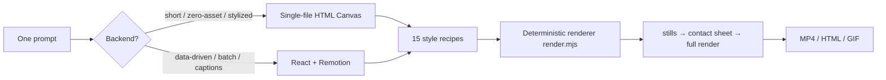

# AgentMotion

**One prompt, one film — every frame drawn in code.** · *一句话出片 · 纯代码视频生成统一框架*

<p align="center">
  
  
  
  
</p>

> AgentMotion is an **Agent Skill** for programmatic video: it makes AI agents draw every frame in code and render a real MP4 — no generated assets, no diffusion video models. Every frame is a pure function of the frame number, `frame = f(t)`: deterministic, self-checkable, parallelizable, re-renderable.

For: story shorts · explainers · product promos · data recaps (Wrapped-style) · style catalogs · seamless GIF loops.

<p align="center">
  
</p>

---

## Why it exists

The community proved that *strong reasoning model + Node/Chrome/ffmpeg* can render video purely from code — but the know-how is scattered across a dozen independent skills and prompt collections. AgentMotion converges them into one pipeline:

> **one entrypoint → two backends → 15 style recipes → one QA loop**



## Features

- **Two backends**: zero-asset single-file Canvas (default) and React+Remotion (data-driven, batch personalization, burned-in captions).
- **15 production-grade style recipes**: frame-by-frame hand-drawn / isometric 2.5D / flat vector / line art / 3D / morphing / sticker explainer / cyberpunk HUD / collage / glassmorphism / Bauhaus / synthwave / pixel art / liquid motion / variety-show lettering — each broken down into *palette / technique / motion / pitfalls*.
- **Deterministic renderer**: one `render.mjs` command for MP4, frame-exact stills, or contact sheets, with multi-worker parallelism.
- **Audio-visual co-timing**: picture and music read the same `SECTIONS/SHOTS/EVENTS` timing data, so cuts land on the beat by construction.
- **Host-agnostic**: a proper Agent Skill, yet callable by any shell-capable agent (Cursor / Codex / custom) and usable as a plain CLI.

## Quick start

```bash
# 0) env check (Node 18+ / ffmpeg / Chrome or Edge)
node scripts/env-check.mjs
npm i playwright-core

# 1) run the minimal demo (8 s)
node scripts/render.mjs examples/hello-drop.html sheet.jpg --sheet 1   # contact sheet first
node scripts/render.mjs examples/hello-drop.html out.mp4               # full film

# 2) make your own
cp templates/starter.html my-film.html     # edit SECTIONS / SHOTS / PALETTE / world drawing
node scripts/render.mjs my-film.html preview.mp4 --workers 6
node scripts/probe.mjs preview.mp4 1920x1080 30
```

## Repository layout

```
AgentMotion/
├── SKILL.md              # agent entrypoint: backend → style → workflow → anti-failure rules
├── AGENTS.md             # generic instructions for any shell-capable agent
├── scripts/              # render.mjs (deterministic) · env-check · probe
├── templates/            # starter.html (frame=f(t) contract + camera + beat system)
├── styles/               # 15 style recipes (recipes.md)
├── references/           # workflow / storyboard / techniques / qc / audio / backends
├── examples/             # hello-drop.html (runnable out of the box)
└── docs/                 # architecture & credits
```

## Design principles

1. **frame = f(t)**: purity is the shared precondition for deterministic rendering, parallel frame extraction, and per-frame self-checks.
2. **Check before you render, stills before the full film**: contact sheets and frame-exact stills are the cheapest correction surface.
3. **Audio-visual co-timing**: picture and score share timing data, so cuts land on the beat.
4. **Auditable knowledge**: every recipe is written to palette/technique/motion/pitfall granularity.
5. **Zero-asset promise**: no generated images, fonts, or diffusion-model output — everything is computed.

## Relation to the upstream community

AgentMotion is inspired by public community methods (the "one-prompt Opus video" prompt collections, PDoomVideo / ClaudeAnimationBase's hand-painted pipeline, the Remotion ecosystem, etc.). **All code and docs here are original rewrites** and contain no copied copyrighted material. See [docs/architecture.md](docs/architecture.md) for credits.

## Roadmap

- [ ] `sync-check.mjs`: on-beat & loudness-jump validation for cuts
- [ ] `layout-check.mjs`: automatic text-collision detection
- [ ] Remotion scaffolding (`templates/remotion/`)
- [ ] Synthesized-score templates (Web Audio `SCORE`)
- [ ] MCP Server wrapper

## Contributing

PRs welcome — see [CONTRIBUTING.md](CONTRIBUTING.md). New recipes need the four-part structure and must be verifiable with the renderer; scripts stay zero-hard-dependency and cross-platform.

## License

[MIT](LICENSE) © 2026 AgentMotion contributors
