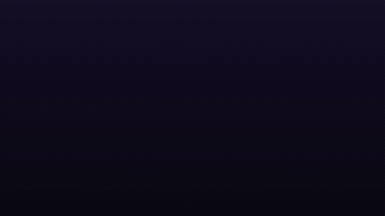
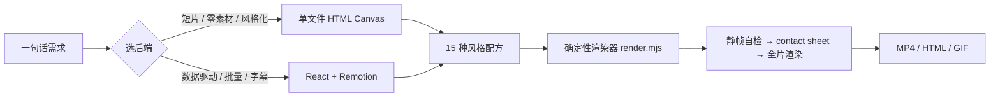

# AgentMotion

**一句话出片 · 纯代码视频生成统一框架** · *One prompt, one film — every frame drawn in code.*

<p align="center">
  
  
  
  
</p>

> AgentMotion 是一个面向 AI Agent 的视频创作技能包（Agent Skill）：让模型用**代码逐帧绘制**并渲染出真正的 MP4——不生成素材、不调用扩散视频模型。每一帧都是帧号的纯函数 `frame = f(t)`，完全确定性：可自检、可并行、可复渲。

适用：故事短片 · 科普讲解 · 产品宣传 · 数据盘点（Wrapped 式）· 风格目录片 · 无缝循环 GIF。

<p align="center">
  
</p>

---

## 为什么需要它

社区已经证明「强推理模型 + Node/Chrome/ffmpeg」就能纯代码出片，但相关知识散落在十几个独立技能与案例库里，入口互不相通、模型各说各话。AgentMotion 把它们收敛为：

> **一个入口 → 两种后端 → 15 种风格配方 → 一条质检流水线**



## 特性

- **双后端**：零素材单文件 Canvas（默认，agent 一遍写对概率最高）与 React+Remotion（数据驱动、批量个性化、烧录字幕）。
- **15 种商用级风格配方**：逐帧手绘 / 等轴 2.5D / 扁平矢量 / 线条动画 / 3D / 形变 / 贴纸科普 / 赛博朋克 HUD / 拼贴 / 玻璃拟态 / 包豪斯 / Synthwave / 像素风 / 液态流动 / 综艺花字。每条配方都拆到「调色板 / 技法 / 运动 / 避坑」粒度。
- **确定性渲染器**：`render.mjs` 一行命令出 MP4 / 指定时刻静帧 / contact sheet，多 worker 并行出帧。
- **音画同源**：画面与配乐读同一份 `SECTIONS/SHOTS/EVENTS` 时间数据，切点天然落在节拍上。
- **宿主无关**：既是 Agent Skills 技能，也可被任何有 shell 的 Agent（Cursor/Codex/自研）调用，人也能直接当 CLI 用。

## 快速开始

```bash
# 0) 环境体检（Node 18+ / ffmpeg / Chrome 或 Edge）
node scripts/env-check.mjs
npm i playwright-core

# 1) 跑通最小示例（8 秒）
node scripts/render.mjs examples/hello-drop.html sheet.jpg --sheet 1   # 先看拼图
node scripts/render.mjs examples/hello-drop.html out.mp4               # 全片

# 2) 做你自己的片
cp templates/starter.html my-film.html     # 改 SECTIONS / SHOTS / PALETTE / 世界绘制
node scripts/render.mjs my-film.html preview.mp4 --workers 6
node scripts/probe.mjs preview.mp4 1920x1080 30
```

## 目录结构

```
AgentMotion/
├── SKILL.md              # Agent 入口：选后端 → 选风格 → 工作流 → 防翻车规则
├── AGENTS.md             # 任意 shell 型 Agent 的通用说明
├── scripts/              # render.mjs（确定性渲染）· env-check · probe
├── templates/            # starter.html（frame=f(t) 契约 + 相机 + 节拍系统）
├── styles/               # 15 种商用级风格配方（recipes.md）
├── references/           # 工作流 / 分镜 / 技法 / 质检 / 音画 / 后端选型
├── examples/             # hello-drop.html（可立即运行）
└── docs/                 # 架构与致谢
```

## 设计原则

1. **帧 = f(t)**：纯函数是确定性渲染、并行出帧、逐帧自检的共同前提，写进每条规则。
2. **自检先于渲染，静帧先于全片**：contact sheet 与指定时刻静帧是最便宜的纠错面。
3. **音画同源**：画面与配乐共享时间数据，切点自然在拍上。
4. **知识可审计**：每个配方写到「调色板/技法/运动/避坑」粒度，模型照做即可复现质感。
5. **零素材承诺**：不引入生成式图片/字体/扩散模型输出，全部由代码计算。

## 与上游社区的关系

本项目受社区公开案例与方法论启发（「用 Opus 一句话出片」提示词案例库、PDoomVideo / ClaudeAnimationBase 的手绘动画流水线、Remotion 官方生态等），**所有代码与文档均为原创重写**，未复制上游受版权保护的内容。详见 [docs/architecture.md](docs/architecture.md) 致谢一节。

## 路线图

- [ ] `sync-check.mjs`：切点在拍与响度跳变自动校验
- [ ] `layout-check.mjs`：文字碰撞自动检测
- [ ] Remotion 模板脚手架（`templates/remotion/`）
- [ ] 配乐合成模板库（Web Audio `SCORE`）
- [ ] MCP Server 封装

## 参与贡献

欢迎 PR，门槛见 [CONTRIBUTING.md](CONTRIBUTING.md)：新配方需包含四段式结构并可用渲染器验证；脚本保持零硬依赖、三平台可用。

## License

[MIT](LICENSE) © 2026 AgentMotion contributors
